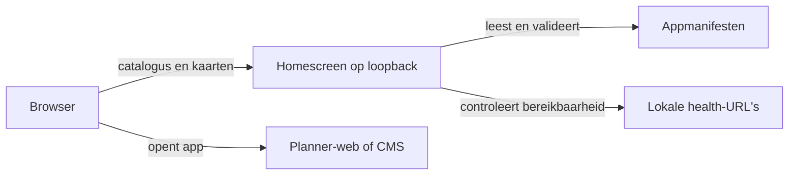

# Draconis-apps

Onderhouder: Draconis Labs. Laatst nagekeken op 21 november 2026.

- [Registreer een app en controleer het manifest](creating-an-app.md).
- [Start de lokale appcatalogus met fictieve doelapps](lokale-appcatalogus.md).
- [Controleer browserbediening, toegankelijkheid en performance](appkwaliteit.md).

Kijk in [Ready en Done voor werkitems](../azure/work-item-acceptance.md)
welk bewijs bij een PR of Azure Boards-item hoort. Werk deze index en de
betrokken handleiding bij als een start- of controleopdracht verandert.

## Lokale topologie

De appcatalogus bepaalt welke kaarten in het lokale profiel zichtbaar zijn.
Planner en CMS bepalen zelf of een gebruiker toegang krijgt tot hun
functies. De catalogus ontvangt geen app-tokens.
